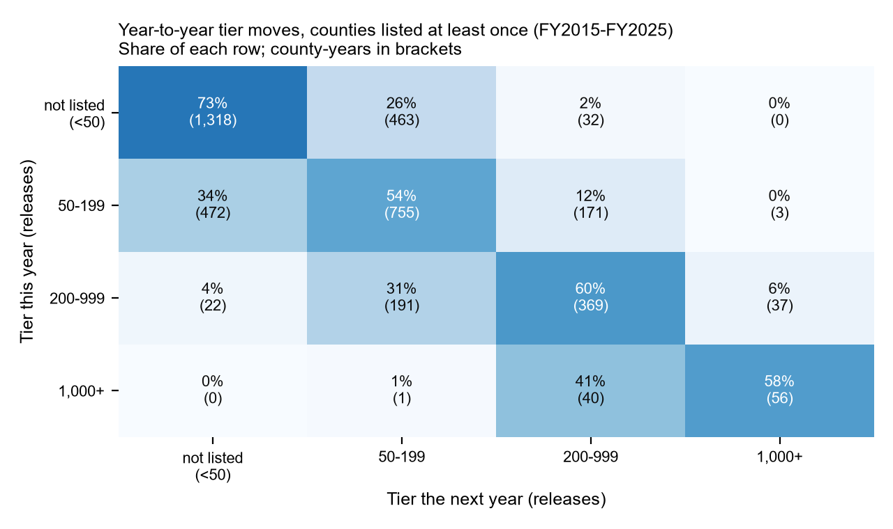
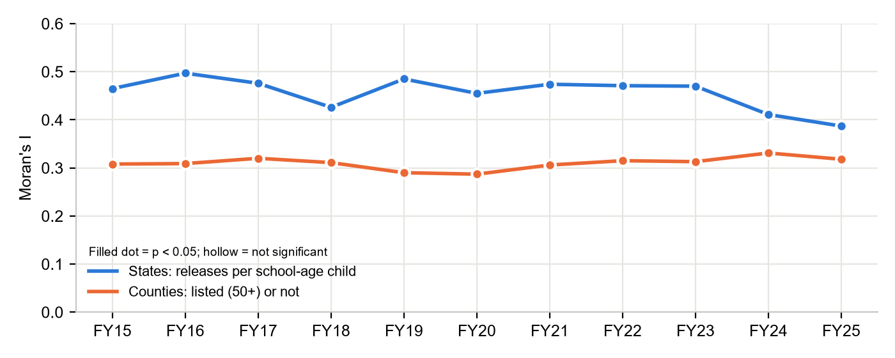
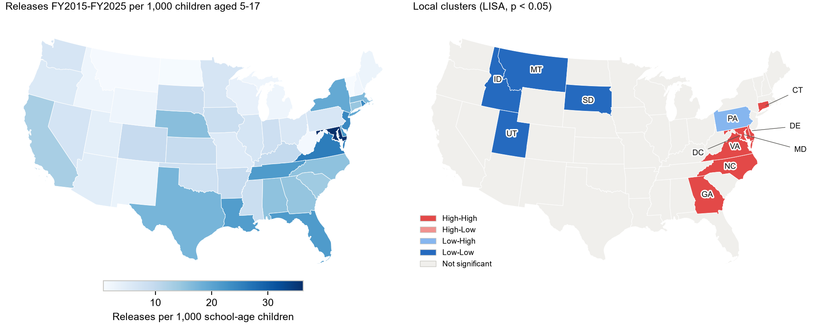
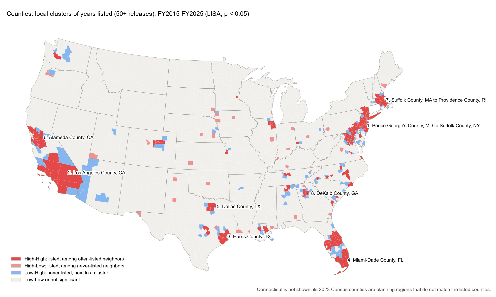
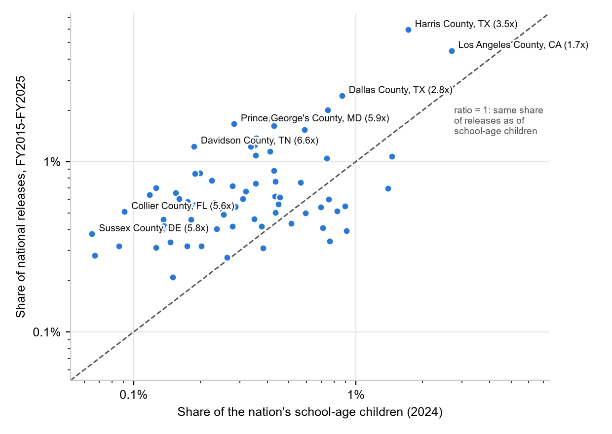

# Week 4 findings memo: concentration, stability and geography

*Where Unaccompanied Children Are Placed. Unaccompanied children released to sponsors, FY2015–FY2025. Built from the data by `python src/build_week4_memo.py` on October 26, 2026; every number is read from `results/`. Service planning only.*

**Check-in question:** is the pattern stable enough that last year predicts next year?

**Answer.** For states, yes. State rankings barely move from one year to the next (rank correlation 0.985 or higher every year), and simply reusing last year's shares misses each state's share by 0.21 percentage points on average, the best of the three simple rules tried. For counties, *where* children are released is just as steady, but *how many* counties cross ORR's 50-release publication threshold rises and falls with national volume, so a county's size tier last year is a weaker guide than its share. Releases are also clustered in space: eight metropolitan clusters received 51% of all children released in FY2015–FY2025.

## Terms

- **Release:** an unaccompanied child released by ORR to a sponsor, counted at the first release location.
- **Listed county:** a county with 50 or more releases in a fiscal year. ORR and MPI publish only these.
- **Other counties:** the rest of a state, kept as one group. Never split or estimated.
- **Share:** a place's part of the national total in a fiscal year (October to September).
- **School-age ratio:** a place's share of releases divided by its share of the nation's children aged 5–17. 1.0 means in proportion; 2.0 means twice its share. It describes relative service need (for example, for schools), not the community.

## 1. Concentration

- **States.** Each year releases were as concentrated as if spread evenly over 14–17 states (the effective number, 1 / HHI). The ten largest states took 64%–75% of releases. Concentration has eased slowly: the top-ten share was 70%–75% in FY2015–FY2019 and 64%–70% in FY2021–FY2025.
- **Counties.** In the high-volume years FY2021–FY2024 the effective number of places was 32–44; in the low-volume years FY2020 and FY2025 it fell to 7 and 8. Part of this is the threshold: when fewer counties reach 50 releases, more children fall in the unlisted group, which counts as a single place.

## 2. Stability

- **State rankings.** Year-to-year rank correlations of state shares: Spearman 0.985–0.996, Kendall 0.910–0.962. Simple rules for next year's state shares, scored on FY2018–FY2025 (weighted by releases):

| Rule | Mean absolute error (share points) | Log score per release (higher is better) |
|---|---|---|
| Last year's shares | 0.212 | -3.1678 |
| Mean of last 3 years | 0.227 | -3.1693 |
| All earlier years pooled | 0.294 | -3.1768 |

- **County tiers.** Each of the 393 counties listed at least once is placed in a tier every year. A county with 1,000+ releases stays in that tier the next year 58% of the time and moves to 200–999 41% of the time. A county with 50–199 releases falls below the threshold the next year 34% of the time. These moves follow national volume: 226 counties were listed in FY2019, 73 in FY2020, 338 in FY2022 and 109 in FY2025.

## 3. Geography: releases cluster

- **Overall clustering (Moran's I).** States with high release rates per school-age child border other high-rate states: Moran's I = 0.48 (p = 0.0001, 49 contiguous states and DC). Counties that are often listed border other often-listed counties: Moran's I = 0.40 (p = 0.0001, 3,100 counties). Moran's I runs from -1 to +1; 0 means no spatial pattern.
- **Steady over time.** Every year from FY2015 to FY2025 both tests are significant (p < 0.05): Moran's I 0.39–0.50 for states and 0.29–0.33 for counties. Clustering did not weaken in the surge years or the low years.

- **Local clusters, states (LISA).** High-High: MD, DC, VA, DE, NC, GA, CT (high rates among high-rate neighbors). Low-Low: MT, ID, UT, SD. Low-High: PA. With only 49 places, no single state cluster passes a false-discovery-rate correction, so read the state clusters as suggestive; the overall result above is strong.

- **Local clusters, counties (LISA).** 151 counties are High-High (105 pass the false-discovery-rate correction). Grouped by shared borders they form 31 clusters; the eight largest hold 51% of all FY2015–FY2025 releases.

| # | Cluster (largest counties at each end) | States | Counties | Share of national releases | Average years listed (of 11) |
|---|---|---|---|---|---|
| 1 | Prince George's County, MD to Suffolk County, NY | NJ NY MD PA VA | 53 | 20.8% | 7.8 |
| 2 | Los Angeles County, CA | CA | 9 | 6.8% | 9.4 |
| 3 | Harris County, TX | TX | 5 | 6.3% | 7.0 |
| 4 | Miami-Dade County, FL | FL | 6 | 5.3% | 9.3 |
| 5 | Dallas County, TX | TX | 4 | 3.5% | 9.5 |
| 6 | Alameda County, CA | CA | 12 | 3.4% | 7.7 |
| 7 | Suffolk County, MA to Providence County, RI | MA NH RI | 9 | 2.6% | 7.9 |
| 8 | DeKalb County, GA | GA | 6 | 2.3% | 8.8 |

## 4. Release shares compared with school-age population

- **Listed counties** took 1.4–2.0 times their share of the nation's school-age children each year; **other counties** as a group took 0.3–0.6 times. The listed-county ratio was highest in FY2015 (2.0) and FY2020 (2.0) and lowest in FY2024 (1.4): in low-volume years releases concentrate in fewer places.
- **70 counties were listed in all 11 years.** Together they received 59% of all releases but have 31% of the nation's school-age children. 58 of the 70 have a ratio above 1; the median is 2.2.

| County | Releases FY2015-FY2025 | Per 1,000 children aged 5-17 | School-age ratio |
|---|---|---|---|
| Davidson County, TN | 8,861 | 86.8 | 6.6 |
| Prince George's County, MD | 11,966 | 77.6 | 5.9 |
| Sussex County, DE | 2,705 | 76.8 | 5.8 |
| Collier County, FL | 3,659 | 73.6 | 5.6 |
| Jefferson Parish, LA | 5,031 | 73.2 | 5.5 |
| Mercer County, NJ | 4,584 | 71.0 | 5.4 |
| Union County, NJ | 6,138 | 59.5 | 4.5 |
| Palm Beach County, FL | 12,844 | 58.9 | 4.5 |

## What this means for the next phases

- **Week 5 (share model).** "Last year's shares" is a strong baseline (0.21 share points); the Bayesian model has to beat it on held-out years, or the write-up explains why not.
- **Week 6 (scenarios).** County counts depend on whether a county clears the 50-release threshold, which depends on national volume. Reporting scenarios by cluster and by state, alongside listed counties, keeps ranges honest. The school-age ratios show where the same national volume means the largest relative need for school services; ORR's published age mix will turn releases into school-age children.

## Methods and limits

- **Data.** Migration Policy Institute tabulation of ORR releases to sponsors (state and listed county, FY2015–FY2025); Census Bureau Vintage 2024 estimates of children aged 5–17 (July 1, 2024, used as one reference year for every fiscal year); Census 2023 cartographic boundary files (1:20m).
- **Neighbors.** Queen contiguity (shared border or corner), row-standardized, for the 48 contiguous states and DC. Alaska, Hawaii and the territories have no land neighbors and are left out. A few island counties are linked to their nearest county. Connecticut's four listed counties are left out of the county analysis because its 2023 Census counties are planning regions that do not match them.
- **Tests.** Moran's I and LISA with 9,999 random permutations and a fixed seed; local clusters at p < 0.05, with false-discovery-rate counts reported alongside (`results/lisa_summary.csv`).
- **County variable.** Years listed (0–11) uses only the published fact that a county had 50 or more releases in a year. Counties under the threshold are never estimated or backed out.
- **School-age ratio.** First release location only, not later moves. Released children are not all of school age. Counties without a population match (Connecticut) are left out of both shares.
- **Tiers.** The transition matrix covers counties listed at least once, so moves into and out of "not listed" are among counties that were listed in some year.

## Files

- Code: `src/geography.py` (Moran's I, LISA, school-age comparison), `src/measure.py` (concentration, persistence, tiers), `src/share_baseline.py`, this memo's builder `src/build_week4_memo.py`.
- Tables: `results/moran_global.csv`, `moran_by_year.csv`, `lisa_states.csv`, `lisa_summary.csv`, `lisa_county_clusters.csv`, `school_age_comparison.csv`, `county_school_age_always_listed.csv`, `tier_transitions.csv`, `county_tiers_by_year.csv`.
- Charts: `results/figures/week4_*.png`.
